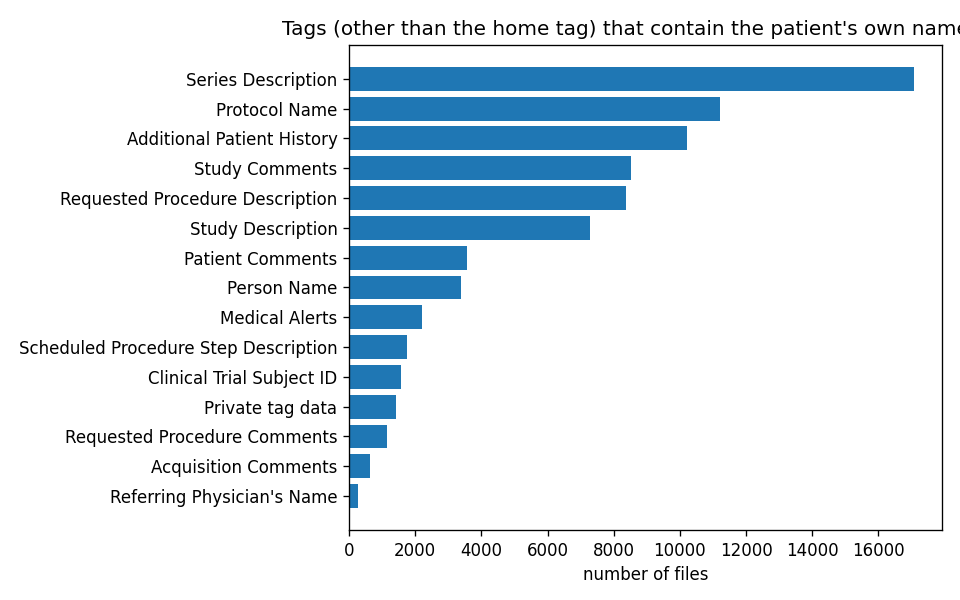
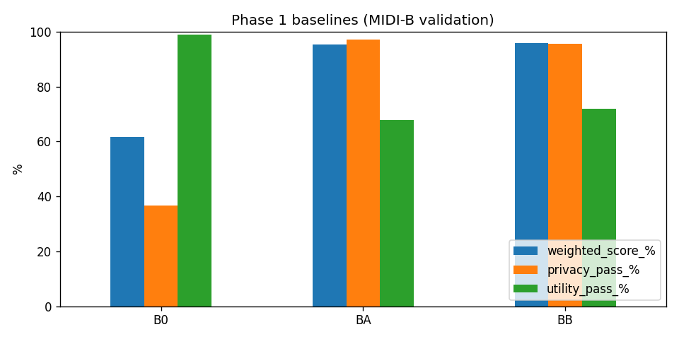

# Phase 1: Where the PHI is, and three baselines

Notebook: [`01_exploration_and_baseline.ipynb`](../notebooks/01_exploration_and_baseline.ipynb) ·
code: [`baselines.py`](../src/fpdeid/baselines.py), [`ps315.py`](../src/fpdeid/ps315.py),
[`census.py`](../src/fpdeid/census.py), [`phi_locations.py`](../src/fpdeid/phi_locations.py)

## Tag census

Across all 23,921 files there are 1,444 distinct tag paths: 439 standard tags at the top level, 384 inside sequences,
602 private tags at the top level and 19 private tags inside sequences, from 23 vendor blocks (mostly GE PET/CT).
1,277 of the 1,294 tag paths the answer key checks are in the census; the other 17 are private tags inside private
sequences and one retired tag.

## The name is everywhere

I took each patient's name, ID, birth date and accession number from their own fields and searched every other field of
the same file. In 23,641 of 23,921 files (98.8%) the patient's name or ID turns up somewhere else.

| Field | Files with the name/ID | Basic Profile action |
|---|---|---|
| Series Description (*"PET-CT SERIES for Peggy Peters"*) | 9,236 | delete |
| Additional Patient History | 7,004 | delete |
| Protocol Name | 6,975 | dummy |
| Study Comments | 5,815 | delete |
| Requested Procedure Description | 5,655 | empty |
| Study Description | 5,168 | delete |
| Private tags | 1,098 | delete all |

These descriptions are exactly what a researcher uses to find the right series, so deleting them is expensive. This table
is where the fingerprint idea of Phase 3 came from.

Two smaller things showed up: *Series Number* often holds a date (`20160807`), which costs the best baseline 21,268 checks,
and the 35 pixel checks in the key are all X-ray type images (DX, CR, MG) with lines such as
*"JAMES RUSSELL [M] 12.13.2018 / DOB: 10.21.1947"*.

Most of the answer key is about keeping data: 3,453,539 `text_retained` and 1,101,091 `tag_retained` checks against
343,583 `text_removed`. The score is weighted 70% HIPAA, 20% DICOM, 10% TCIA best practice.

## Baselines

B0 only replaces UIDs and the Patient ID (so the scorer can match files). BA is the PS3.15 Basic Application Level
Confidentiality Profile, parsed straight from NEMA's `part15.xml` by [`parse_ps315_table.py`](../scripts/parse_ps315_table.py)
(657 attributes). BB adds the options *Retain Longitudinal Temporal Information with Modified Dates*, *Retain Patient
Characteristics* and *Retain Device Identity*.

| | B0 | BA | BB |
|---|---|---|---|
| Weighted score | 61.51% | 95.31% | 95.87% |
| HIPAA | 45.83% | 99.99% | 99.99% |
| TCIA best practice | 94.49% | 53.42% | 59.01% |
| Privacy checks failed | 454,324 | 21,358 | 31,131 |
| Utility checks failed | 55,371 | 1,670,457 | 1,458,139 |
| Valid DICOM (1,000-file sample) | 100% | 99.8% | 99.5% |

BB removes almost every identifier but loses about a third of the useful data: 79,548 failures on *Private Creator*
alone, roughly 8,000 on each GE PET acquisition parameter, and about 23,000 each on study and series descriptions.
MR (68.7% of checks passed), PET (75.6%) and CT (83.0%) suffer most because they carry the most private tags.

## Things that went wrong on the way

My first BA run crashed on 561 CT files: the table marks sequences such as *Referenced Image Sequence* with "U", and I was
trying to put a new UID into the sequence itself. For sequences the action now means "keep it and apply the rules inside".

The same first version left only about 70% of files valid, because dummy sequences kept an empty item and some
"remove or empty" sequences were emptied where the standard needs one item. After fixing that, 99.5-99.8% have no new
error. The rest is *Acquisition Context Sequence*, which must exist even when empty; I left that for the rules engine.

For the combined actions in the table ("X/Z", "Z/D") I chose whichever keeps the file valid. The Basic Profile empties
Patient ID, which neither research nor the scorer can live with, so it always gets the pseudonym from the mapping table.

The answer key is read in chunks of 2,000 rows, and a helper cuts out a small key for dev-mini so a quick experiment takes
minutes, not the full 15-minute scorer run.
