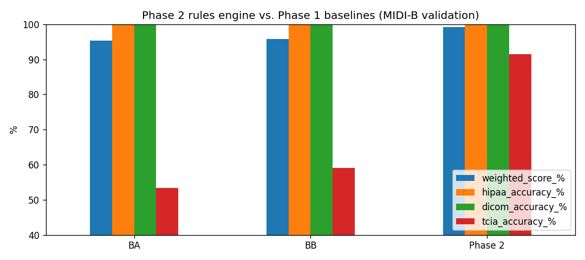

# Phase 2: Policy-driven rules engine and audit log

**Notebook:** [`notebooks/02_rules_engine.ipynb`](../notebooks/02_rules_engine.ipynb)
**Code:** [`src/fpdeid/engine.py`](../src/fpdeid/engine.py), [`src/fpdeid/checks.py`](../src/fpdeid/checks.py)
**Policy:** [`configs/policy_phase2.yaml`](../configs/policy_phase2.yaml) (the policy as it was at the end of this phase)
**Tests:** [`tests/test_engine.py`](../tests/test_engine.py)
**Results:** [`results/phase2/`](../results/phase2/)

## What this phase is about

A hospital that wants to share scans writes down a **policy**: which fields must be removed, which dates must be shifted,
which IDs must be replaced by pseudonyms, and what must be kept for research. In this phase I turned such a policy
into a program:

1. The policy is a plain text file ([`configs/policy_phase2.yaml`](../configs/policy_phase2.yaml)) that a person can read and change.
2. The **rules engine** reads it and decides, for **every field of every file** (also fields hidden inside sequences
   and vendor-specific private fields), one action: remove, empty, dummy value, pseudonym, date shift or keep.
3. Every change is written to an **audit log**, with the reason, the part of the DICOM standard (PS3.15) it implements,
   and the GDPR idea it serves. The log never contains the original value, only a short hash of it.

## What the policy says

| Part | Rule |
|---|---|
| Base | DICOM PS3.15 Basic Profile (Table E.1-1, 657 attributes) |
| Options | *Retain Patient Characteristics* (age, sex, size, weight) and *Retain Longitudinal Temporal Information with Modified Dates* (dates shifted per patient) |
| Pseudonym key | Patient IDs and **every UID found in the key table** are replaced, wherever they are |
| Private tags | Decided by **value type**: numbers and codes are kept; dates shifted; UIDs pseudonymised; free text and binary removed; entries of the standard's *Safe Private* table (E.3.10-1) always kept |
| Value checks | A number that is really a date (e.g. Series Number `20160807`) or a Unix time stamp (in a field named *time/date/stamp*) is shifted like a date |
| Sequences | Kept and cleaned inside (references to other images, structured report content), never kept blindly |
| Device identity | Serial numbers, station names and network (AE) titles removed; manufacturer and model kept |
| File validity | Required fields missing in the input are added (empty, or with the value implied by the file type) |

Each action carries a GDPR label, for example:

| Action | GDPR idea |
|---|---|
| Remove / empty / dummy | Data minimisation (Art. 5(1)(c)) |
| Pseudonym from the key, date shift | Pseudonymisation (Art. 4(5)), the output is **still personal data** (Recital 26), because the key exists |
| Keep | Purpose limitation (Art. 5(1)(b)), needed for research, does not identify the patient |

An audit entry looks like this:

| tag | keyword | action | reason | PS3.15 option | GDPR |
|---|---|---|---|---|---|
| (0010,0020) | PatientID | P | replaced by its pseudonym from the key | basic_profile | Pseudonymisation (Art. 4(5)) ... |
| (0008,0020) | StudyDate | S | PS3.15 Table E.1-1: Study Date | retain_long_modified_dates | Pseudonymisation (Art. 4(5)) ... |
| (0010,0010) | PatientName | Z | PS3.15 Table E.1-1: Patient's Name | basic_profile | Data minimisation (Art. 5(1)(c)) ... |

## Results (MIDI-B validation set, 23,921 files, official scorer)

| | BA (Basic Profile) | BB (best baseline) | **Phase 2** |
|---|---|---|---|
| **Weighted MIDI-B score** | 95.31% | 95.87% | **99.15%** |
| HIPAA checks | 99.989% | 99.988% | **99.994%** |
| DICOM checks | 99.885% | 99.885% | **100.000%** |
| TCIA best-practice checks | 53.42% | 59.01% | **91.54%** |
| Privacy checks failed (leaks) | 21,358 | 31,131 | **4,577** |
| Utility checks failed (over-cleaning) | 1,670,457 | 1,458,139 | **302,210** |
| UID / Patient ID consistency failures | 32 | 32 | **0** |



Per check type: date shifting, UID replacement, UID consistency, Patient ID consistency, pixel preservation,
"tag must exist" and "tag must not be empty" are all at **100%**.

### Pass criteria

| Check | Target | Result |
|---|---|---|
| MIDI-B weighted score | ≥ 97% and better than the best baseline | **99.15%** |
| Research-critical fields kept unchanged (42 fields, [`configs/utility_tags.yaml`](../configs/utility_tags.yaml)) | 100% | **100%** |
| Valid DICOM (no new `dciodvfy` error), all 23,921 files | 100% | **100%** |
| Date intervals kept | 100% | **100%** |
| Original UIDs left in the output | 0 | **0** |
| Patients / studies / series / instances before = after | 100% | **216 / 241 / 280 / 23,921** |
| Audit coverage (changes found by an independent diff that are in the log) | 100% | **100%** (1,349,623 changes) |
| Same input → byte-identical output | 100% | **100%** |
| Errors while cleaning | 0 | **0** |
| Accuracy on "keep" checks | ≥ 99.5% | 94.19%, see below |
| Speed |, | **1,354 files/s ≈ 49,000 studies/hour** |

### What is still failing, and why

| Cause | Failed checks | Where it gets fixed |
|---|---|---|
| Private **text** tags (e.g. PET software version, tracer name), removed because text may hold a name | 235,125 | Phase 3 (fingerprint decides per value) |
| Free-text fields (Study/Series Description, Protocol Name, ...), removed because they contain the patient's name | 63,296 | Phase 3 (remove only the name, keep the rest) |
| Private numbers that TCIA's vendor knowledge base removes (all `0`, not PHI) | 4,519 | not planned: needs a vendor-specific list |
| Icon images (small thumbnails), removed on purpose, they can show burned-in text | 1,763 | kept removed |
| Burned-in text in X-ray pixels | 29 | Phase 4 |

So the remaining gap is almost entirely **useful text that rules alone cannot clean safely**. The "keep" target of
99.5% cannot be reached without looking at the values; that is exactly what the fingerprint in Phase 3 does.

## Problems I solved

**1. 1.3 million private-tag values were being deleted.**
The Basic Profile deletes every private tag, but most of them are harmless scanner settings (for example PET
reconstruction parameters) that TCIA keeps. TCIA's private-tag knowledge base is not available as a download, and copying
the answer key would be cheating. So I used a rule that works for **any vendor**: a value that is a number or a code cannot
contain a name, so it is kept; dates are shifted, UIDs replaced, and free text removed (until Phase 3 can check it).
This alone raised the TCIA best-practice score from 59% to over 91%.

**2. A private tag label must stay if its block stays.**
Private tags belong to a "block" that starts with a label (the *private creator*). The engine keeps the label only if at least
one tag of its block is still there, and removes empty blocks.

**3. UIDs hidden deep inside structured reports.**
In the first run, 236 UIDs inside structured report sequences were not replaced. The reason: sequences not mentioned in the
PS3.15 table were kept as they were. Now **every kept sequence is cleaned inside**, and **every UID that is in the pseudonym
key is replaced, in whatever field it is**. After this, all 234,418 UID checks and all consistency checks pass.

**4. Dates hidden in number fields.**
*Series Number* often contains a date (`20160807`), and one GE private field stores the acquisition time as Unix seconds
(`1228050572` = 30 Nov 2008). A rule per field would miss these, so the engine checks the **value**: an 8-digit number that is
a valid date is shifted like a date; an integer in a field whose name mentions *time/date/stamp* and whose value is a plausible
Unix time (1990–2030) is shifted by the same number of days. The name condition stops large counts (for example PET event
counts) from being changed by mistake. The DICOM standard itself warns that "even a DS or IS string could be misused".

**5. Keeping files valid DICOM.**
Some fields are required by the DICOM rules but were missing or empty in the input (for example *KVP* in CT, or
*Presentation Intent Type* in digital X-ray). The policy adds them, empty where allowed, or with the only value the file type
allows (`FOR PRESENTATION`, `IDENTITY`/`INVERSE`, laterality `U`). Sequences that must be present are kept and cleaned
instead of deleted. Result: 100% of files without new validity errors.

**6. Device identity.**
The standard option *Retain Device Identity* keeps serial numbers, station names and network titles, which identify the
hospital and caused about 10,000 leaks in the best baseline. My policy removes them and keeps manufacturer and model,
which researchers need.

**7. An audit log that does not leak.**
The log stores only a short hash of each old value, never the value itself. To make sure the log is complete, I wrote an
independent checker ([`src/fpdeid/checks.py`](../src/fpdeid/checks.py)) that compares every input and output file field by
field and looks up each difference in the log: all 1,349,623 changes are logged.

**8. Measuring validity fairly.**
Some validator messages contain a UID inside the text. Because UIDs change on purpose, the same old error looked "new".
The checker now masks UIDs in messages, so only real new problems count.

**9. Repeatable results.**
Pseudonyms come from the key table, date shifts and new UIDs from a hash of the patient ID with a fixed secret.
Running the engine twice gives byte-identical files.

## How to reproduce

```bash
python scripts/dev_eval.py my_run        # quick loop on the 20-patient dev-mini subset (~5 min)
jupyter nbconvert --to notebook --execute --inplace notebooks/02_rules_engine.ipynb   # full run (~15 min)
python -m pytest -q tests
```
