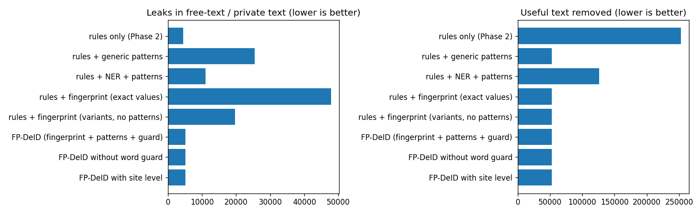

# Phase 3: PHI fingerprint for free text and private tags

Code: [`fingerprint.py`](../src/fpdeid/fingerprint.py), NER comparison in [`ner_baseline.py`](../src/fpdeid/ner_baseline.py) ·
final policy [`policy.yaml`](../configs/policy.yaml) · results in [`results/phase3/`](../results/phase3/)

After Phase 2 the engine deleted descriptions because they sometimes contain the patient's name. But
*"PET-CT SERIES for Amy Wilson"* should become *"PET-CT SERIES"*, not nothing. Most tools find the name with a
named-entity recogniser. I use the patient's own header instead: before cleaning, every patient's identifiers are read
from the fields where they belong (name, IDs, dates, address, phone, institution, device names), written out in all the
ways they appear in text, and searched for in every text value. Only matching words are removed.

The variants matter more than I expected:

| In the header | Also searched for |
|---|---|
| `WILSON^AMY` | *Amy Wilson*, *Wilson Amy*, *A Wilson*, *WILSON*, *AMY* |
| `19811129` | *11/29/1981*, *29.11.1981*, *November 29, 1981*, *29-Nov-1981* and 15 more formats |
| `689-96-0899` | *689960899* |
| `Compton, Holmes and Jones Hospital` | *CHAJH* |

The acronym came from the data: descriptions ended with *"... at CHAJH"*. For identifiers that are in no header field I
added patterns (SSN, phone with extensions, e-mail, *"Dr. X"*, initials after *"by"*, long numbers after *"MRN/ID/#"*,
US postal addresses, a capital-letter site code after *"at"*), and kept each one only if, on the validation key, it removed
nothing the key wanted kept. A word that appears in the text of more than 2% of other patients is never removed on its own
(499 such words, e.g. ABDOMEN, AXIAL). Every removal in the audit log names the entry that matched it.

## Ablation on validation (official scorer)

| Configuration | Score | Text leaks | Useful text removed |
|---|---|---|---|
| Rules only (Phase 2) | 99.150% | 4,548 | 252,630 |
| Rules + patterns only | 97.406% | 25,399 | 53,026 |
| Rules + spaCy NER + same patterns | 98.799% | 11,090 | 126,512 |
| Fingerprint, exact values only | 96.651% | 47,825 | 53,032 |
| Fingerprint with variants, no patterns | 99.077% | 19,735 | 53,032 |
| Fingerprint + variants + patterns + word guard | 99.828% | 5,169 | 53,032 |

Against NER with the same rules and patterns, the fingerprint leaks 5,169 instead of 11,090 and removes 53,032 useful
values instead of 126,512. spaCy (`en_core_web_sm` 3.8) misses unusual names and tags things like *"PET-CT"* as an
organisation.

Two options turned out not to matter on MIDI-B. The word guard changed nothing, because no patient here is called
something like "Brain"; I kept it anyway. Adding every other patient's names and addresses (a site-level fingerprint)
gave no gain and doubled the time, and in one version its "UNKNOWN" entries broke validity, so it is off.

Of the 5,169 text leaks, 5,130 are private numbers that hold `0` and that TCIA's knowledge base removes. 39 are real and
listed in [`leak_list.csv`](../results/phase3/leak_list.csv): 22 short codes that are the entire content of an SR text value
(mostly initials like *"KM"*), 16 bare 10-digit numbers in Patient Comments, and one other. I did not find a rule for those
that would not also delete a lot of valid text.

Final score on validation: 99.828%, with 0 residual fingerprint hits in an independent re-scan, 100% valid DICOM and audit
coverage, and 3-8 ms extra per file.

## Problems along the way

- First version: *"Ordered for by Dr."* was left behind after the surname went. The doctor pattern now runs before the
  fingerprint, and it needs the dot, otherwise the street *"Stern Dr Merced"* was taken for a doctor.
- I first put the clinical-trial sponsor into the fingerprint, but it is an organisation, not the patient, so I took it out.
- About 45,000 checks failed because I removed private-creator labels of blocks that were already empty in the input.
  A label is now removed only if my cleaning emptied the block.
- In 143 files the model name was also stored as a device ID, so the cleaner removed *ManufacturerModelName*. Research
  fields and coded values are now never cleaned.
- PS3.15 uses "C" in more than one option. Only "C" from *Clean Descriptors* means "clean the text"; on *Timezone Offset*
  it comes from the dates option and means remove.
- spaCy crashed with an overflow error with newer `preshed`/`cymem`; pinning `preshed==3.0.9` and `cymem==2.0.8` fixed it.
