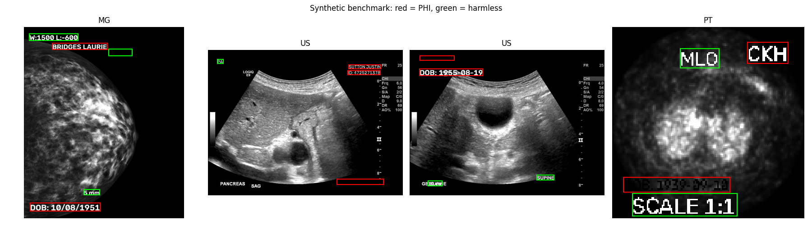

# Phase 4: Text burned into the pixels

Code: [`pixels.py`](../src/fpdeid/pixels.py), synthetic benchmark [`burnin.py`](../src/fpdeid/burnin.py) and
[`pixel_eval.py`](../src/fpdeid/pixel_eval.py) · tests: [`test_pixels.py`](../tests/test_pixels.py)

Some X-rays have *"JONES ERIN [F] 01.12.2019 / DOB: 11.12.1937"* or a technologist's initials written into the image.
Blacking out all text, or fixed bands at the top and bottom, also destroys side markers, *PORTABLE*, scale bars and
window values. So the same idea as Phase 3 applies: read the text and hide only what identifies the patient.

EasyOCR 1.7.2 runs on GPU 0. Each image is read in three views: the normal one, a window over only the brightest values,
and one over the darkest. Small images (128-pixel PET slices) are enlarged to 2000 px first. Pieces on one line are joined,
because OCR splits *"ID: 4107422692"* into two boxes. A line is hidden if it matches the Phase 3 fingerprint (fuzzy,
rapidfuzz ratio ≥ 80, because OCR reads *"PALDWIN"* for BALDWIN), contains a label word (DOB, ID, MRN, NAME, PATIENT) or
a date, or, on X-rays only, is a single short word that looks like initials and is read with confidence ≥ 0.5. The box is
filled with the image's black value plus a margin of 20% of the text height. Nothing outside the boxes changes, and images
with nothing to hide are not rewritten.

Reading every slice of every CT/MR/PET series would be slow, so for those only the first, middle and last slice are read,
and the rest of the series only if one of them has text that would be hidden. X-ray, mammography and ultrasound are always
read. On validation this means OCR on 710 files, 3% of the set.

## A benchmark with known answers

The key has only 35 burned-in checks, too few to tune anything. I wrote text into 400 real validation images (CR, DX, MG,
US and CT/MR/PET slices): 1,647 pieces, 919 of them PHI made from the patient's own identity and 728 harmless. Patients were
split 70/30 into tune and test.

| Test split | PHI boxes hidden | PHI words still readable | Harmless text kept | Area hidden |
|---|---|---|---|---|
| Black out all text | 74.4% | 0 of 540 | 13.5% | 30.7% |
| Black out top/bottom bands | 50.4% | 35 of 540 | 4.8% | 29.2% |
| FP-DeID | 63.0% | 2 of 540 | 79.2% | 14.7% |

"Hidden" means at least 90% of the box is covered, which is strict. Recall is 92-97% on large X-rays and 85% on CT, but
52% on 128-256 px PET slices where letters are 6-8 pixels high. Most of those boxes are also unreadable to the OCR after
cleaning, hence only 2 readable words, but a person might still read some of them. The lost harmless text sits inside the
safety margin of a PHI line next to it.

## On MIDI-B

Weighted score 99.831% (Phase 3: 99.828%), HIPAA 99.996%. 27 of 35 burned-in checks pass, up from 6. 24 files get boxes,
all still valid DICOM. One image of 23,886 that should stay unchanged was changed: OCR noise read as *"Lvo"* with
confidence 0.78. Peak GPU memory 5.2 GB.

The 8 that fail:

| Text | Why |
|---|---|
| *LEITO* (2x) | Portuguese for "bed", a position marker; kept on purpose |
| *LM* | also the mammography view latero-medial; hiding it would hit every mammogram |
| *ICG* (2x), *ROC* (2x), *YH* | read badly (*"Icg"* 0.32, *"Roc"* 0.12) or not at all |

Lowering the initials threshold would catch the two ICG images but also hide noise like *"Lvo"*; I kept 0.5.

## How it got there

The first 8-bit conversion clipped the brightest 1% of values, which is exactly where burned-in text is, so white names
on bright bone were invisible. The bright and dark views fixed that.

The first initials rule hid *LOGIQ, Gn, FR, Map, TRV, AORTA* and similar on 134 ultrasound images. It is now restricted to
X-rays, one clean word, confidence ≥ 0.5, and codes seen in the images of 3 or more patients are kept. 134 became 1.

Screening on "any text found" did not work: with three views the OCR sees something in 72% of plain CT/MR/PET slices
(rulers, noise). Screening on "text that would be hidden" does.

Enlarging small images helped less than I hoped (PET recall 55% to 59%). Tiny text is still the main weakness.

The server's PyTorch was built for a newer CUDA than the driver supports; the project uses torch 2.7.1 for CUDA 12.6.
Some colour images lacked *Planar Configuration* (now set to 0 when missing), and structured reports have no pixels, so
they are skipped.
