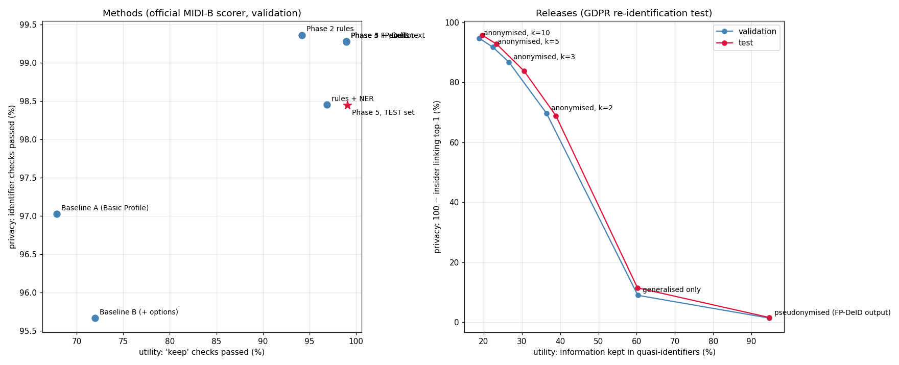

# Phase 5: Auditor, re-identification tests and the test set

Code: [`auditor.py`](../src/fpdeid/auditor.py), [`plant_leaks.py`](../src/fpdeid/plant_leaks.py),
[`reid_attack.py`](../src/fpdeid/reid_attack.py), [`pipeline.py`](../src/fpdeid/pipeline.py),
[`run_split.py`](../scripts/run_split.py) · results in [`results/phase5/`](../results/phase5/)

## Held-out test set

Before touching the test set I froze `configs/policy.yaml` and the code. The test set (322 patients, 29,660 files) was
cleaned and scored once, with the same script as validation.

| | Validation | Test |
|---|---|---|
| Weighted score | 99.831% | 99.805% |
| HIPAA | 99.996% | 99.950% |
| DICOM | 100.0% | 99.995% |
| TCIA best practice | 98.342% | 98.406% |
| Burned-in text checks | 27 / 35 | 25 / 27 |
| UID and patient ID consistency | 100% | 100% |
| Valid DICOM, all files | 100% | 100% |
| Research fields unchanged | 100% | 100% |
| Pipeline time (16 CPUs + GPU) | 28 min | 37 min |

Re-running validation with the frozen code gave exactly the Phase 4 score, so the run is reproducible. For comparison,
the ten finishing teams of the MIDI-B challenge (MICCAI 2024) scored 97.91-99.93% on this test set.

Most failed checks are not leaks: 43,917 are private values empty in the input, 14,914 private tags inside private
sequences that the scorer cannot read, 12,842 private values TCIA removes but that hold no PHI, 6,097 icon images I remove
on purpose. The real leaks are 921 checks (0.10% of 884,700 privacy checks):

| Left in the output | Checks |
|---|---|
| hospital names not in the patient's own header (*"Admitted to White Hospital"*) | 497 |
| 10-digit phone numbers without separators (*"call 7404159161"*) | 135 |
| Unix time as a decimal (*"1348576679.0"*) in a private *Start time (secs)* field | 90 |
| parts of other names not in the header | 76 |
| *Referenced File ID* made of numbers | 64 |
| street addresses not in the header | 45 |
| 2-letter initials in structured reports (*RD, CH, CW*) | 14 |

None of these occurred, or only rarely, in validation, and my phone and timestamp rules do not cover these forms. I have
not changed the rules after seeing them; doing so would make the test score meaningless. They are the first things to fix
in a next version, checked on validation and new data.

## The auditor

[`auditor.py`](../src/fpdeid/auditor.py) imports nothing from the cleaner. It rebuilds each patient's identity from the
original files (all PN values, IDs, accession numbers, birth and study dates in 13 formats including *13 JUN 2017*,
addresses, phones, institution and station names, serial numbers, every original UID), then reads every output value,
including sequences, private tags and bytes that decode as text, and runs its own OCR on X-ray, mammography and ultrasound
images and the middle slice of each CT/MR/PET series. In the pipeline, every header hit is removed and logged in
`audit_auditor_fixes.jsonl`, and the auditor runs again.

To check that it actually finds things, I planted real identifiers back into 120 copies of clean files: names in the other
order, surname alone, IDs, accession numbers, dates in five forms, the doctor, the hospital, an original UID, in six places
(comments, appended to a description, private LO tag, private UN bytes, inside a sequence, patient comments), and 20 with
the name or ID drawn into the pixels. It found 120 of 120. After the fix step it finds 0 and all files still open.

The first version raised false alarms on validation: the private creator *"CTP"*, a Siemens SOP Class UID, the placeholder
*"NONE"*, and *"Long axis"* in a code meaning (one patient is called Long). Rules for private creators, class UIDs,
placeholders and coded values removed those. On the real outputs it then found 0 hits in 4,963,487 validation elements and
55 in 6,689,686 test elements. All 55 are surnames that are also ethnic group words (*WHITE*) in *Ethnic Group*. Not really
leaks, but removing them costs nothing.

The planted-pixel test first found 19 of 20. The bottom-corner text was partly drawn outside the image, and OpenCV 5's
`putText` refuses 16-bit images, so the drawing now goes through an 8-bit mask.

The auditor only knows the patient's own identity, so it could not have found the 921 test leaks above either.

## Re-identification

The quasi-identifiers left in the output are sex, age, weight, height, shifted dates, modalities, scanner make and model,
body part, number of studies and the gaps between them. I tested the three risks named in the Article 29 Working Party's
Opinion 05/2014 on anonymisation: singling out (k-anonymity), linkability (an insider with the original hospital records
matches each shared patient to the record that agrees on most values) and inference (true scan year, birth year, hospital).
Dates are shifted 1-10 years, so comparing scan years only confuses the matching; the insider attack leaves the year out.

The anonymised release is my own construction: 5-year age bands, 10 kg weight bands, no height, no calendar dates (only
gaps in months), no scanner model, then local suppression until every patient shares their values with at least k others.
The first version of the suppression reached only k = 3 on the test set when asked for k = 5, because suppressing one
patient can shrink the group they left. It now repeats until stable and withholds the few patients who are still rare.

Test set, 322 patients:

| Release | Unique | Insider link top-1 / top-5 | Public link top-1 (sex, age, year) | QI information kept |
|---|---|---|---|---|
| Pseudonymised output | 99.4% | 98.4% / 100% | 28.4% | 94.7% |
| Generalised only | 81.1% | 88.5% / 100% | 12.7% | 60.2% |
| Anonymised, k = 2 | 0% | 31% / 79% | 7% | 39% |
| Anonymised, k = 5 | 0% | 7% / 37% | 1.7% | 23% |
| Anonymised, k = 10 | 0% | 4% / 22% | 0.9% | 20% |
| Random guess | | 0.31% / 1.6% | 0.31% | |

Guessing the true scan year from the pseudonymised output: 13.7% against 12.4% for always guessing the most common year.
Birth year: 12.7% against 3.1%, because the exact age is kept. Hospital: no better than chance (the institution names in
MIDI-B are synthetic).

The pseudonymised output can therefore only be shared as personal data under an agreement. Making it anonymous in the
k = 5 sense costs about three quarters of the age, weight and scanner detail on a cohort this small.

The left panel places every method of the project by the scorer's privacy and utility checks; NER sits below the
fingerprint on both. The right panel is the release ladder above.

The complete ablation over all phases is in [`ablation_all_phases.csv`](../results/phase5/ablation_all_phases.csv).
