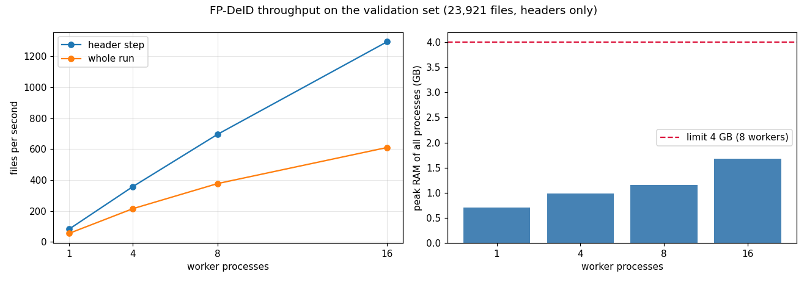

# Phase 6: One command, tests, lineage, speed

Code: [`run.py`](../src/fpdeid/run.py) · tests in [`tests/`](../tests/) · CI: [`.github/workflows/tests.yml`](../.github/workflows/tests.yml)

```bash
python -m fpdeid.run --input DIR --output DIR [--uid-map CSV --patient-map CSV] [--workers 16] [--no-pixels] [--no-auditor]
```

The command finds DICOM files by the `DICM` marker, builds the fingerprints, cleans the headers in worker processes,
runs the pixel step and the auditor, and writes `lineage.jsonl`: for every file the SHA-256 of input and output, the
SHA-256 of the policy, the git commit, the run time and the line numbers of its audit entries. Each cleaned file's audit
line is flushed immediately and OCR results go to `ocr_cache.jsonl`, so a killed run can be started again with the same
command. Without mapping tables, pseudonyms come from a secret in `FPDEID_SECRET`; the MIDI-B results use TCIA's tables
and the default secret so they can be repeated.

## Measured on validation (23,921 files, 241 studies)

| Workers | Header step | Whole run | Studies/hour | Peak memory (PSS) |
|---|---|---|---|---|
| 1 | 84 files/s | 56 files/s | 2,040 | 0.70 GB |
| 4 | 358 | 215 | 7,802 | 0.98 GB |
| 8 | 695 | 377 | 13,685 | 1.15 GB |
| 16 | 1,293 | 610 | 22,133 | 1.68 GB |



With headers, OCR and auditor the run takes 1,787 s (fingerprints 16 s, headers 19 s, pixels 1,683 s, auditor 65 s,
lineage 4 s) and peaks at 3.8 GB. The 8- and 16-worker outputs are byte-identical, the lineage hashes match all 23,921
files, a run killed after 1,860 files and restarted gives the same files as an uninterrupted one, and the output of the
command is byte-identical to the Phase 5 output that was scored.

## Memory

The first benchmark reported 11.4 GB with 8 workers. One worker alone needed 0.2 GB, so the workers were not the problem.
The main process loaded the whole 394 MB audit log as Python objects (about 2.5 GB) to see which files were done, and
the worker pools for the later steps are forked from it. The log is now read line by line, keeping only four values per
file.

I also tried `forkserver` so workers would start clean. It doubled the header step (74 s instead of 35 s), and once the
main process was small it was not needed, so I went back to `fork`. Memory is measured as PSS, because adding up RSS
counts shared pages once per process.

## Tests

69 tests (`python -m pytest -q tests`), 83% coverage of `src/fpdeid`. The integration tests run the whole command on
three 16 x 16 synthetic DICOM files in `tests/data/input` (made by [`make_test_data.py`](../scripts/make_test_data.py)),
with the identity hidden in a description, a comment, a private tag and a date-like Series Number. They check that none of
13 identifiers is left anywhere in the output bytes, that two runs are identical, that a stopped run resumes to the same
result and that the lineage hashes are right. The pixel step is tested with a given OCR result, so no GPU or OCR model is
needed. GitHub Actions runs them on every push; it skips the spaCy and `dciodvfy` tests.

Under coverage, the suite hung once when a worker pool was terminated; I could not reproduce it in three more runs, so
the CI job has a 15-minute timeout.
