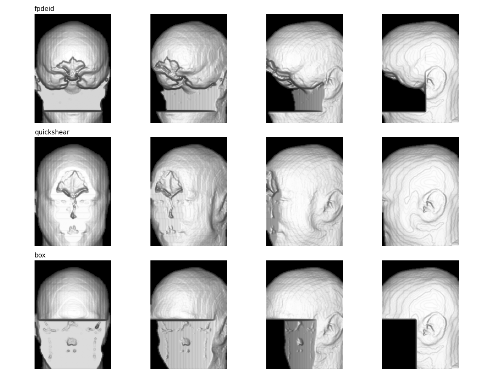
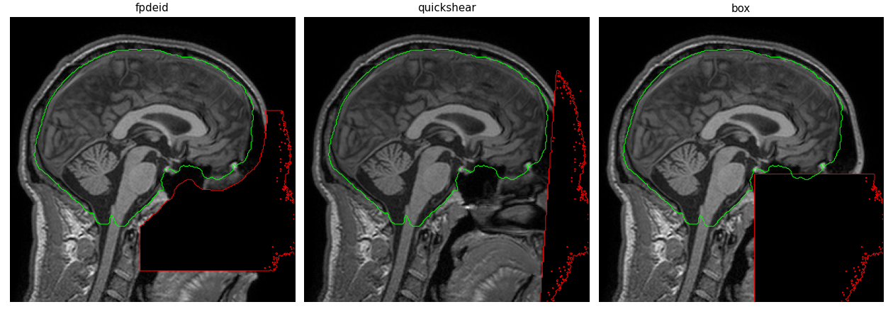

# Phase 7 (optional): Brain-protected defacing of head MRI

**Notebook:** [`notebooks/07_defacing.ipynb`](../notebooks/07_defacing.ipynb)
**Code:** [`src/fpdeid/deface.py`](../src/fpdeid/deface.py)
**Tests:** [`tests/test_deface.py`](../tests/test_deface.py)
**Results:** [`results/phase7/`](../results/phase7/)

## What this phase is about

A head MRI or CT is a 3D picture of the whole head, including the face. Any viewer can turn it into a 3D surface that
looks like the person, and face-recognition software can match it to a photo. Cleaning the header and the burned-in
text does not help: the face is in the image itself. **Defacing** removes the face from the image.

The danger of defacing is cutting too much: research on brain images needs every brain voxel. My method is built so
that the brain **cannot** be touched.

## How it works

1. **Find the brain** with SynthStrip (a published deep-learning skull-stripper that works on any MRI contrast).
2. **Protect it:** the brain mask is made 10 mm larger in every direction. Protected voxels are never changed.
3. **Find the face region from the brain itself:** everything in front of the middle of the brain, below
   "eyebrow level" (the height of the front-most point of the brain, the frontal pole, + 15 mm), and above
   "chin level" (the frontal pole − 120 mm; below that is the neck, which is kept).
4. **Remove it:** face region minus protected voxels is set to the background value.

Because step 4 never touches protected voxels, "0 brain voxels changed" is **guaranteed by construction**, not hoped for.

The same function works on DICOM: a head series (found by *Body Part Examined* or by words such as HEAD / BRAIN) is
stacked into a 3D volume using each slice's position, defaced, and only the changed pixels are written back. Every
header value stays the same.

## How I tested it

**Data:** 30 T1 head MRI scans of the public IXI data set (CC BY-SA 3.0). 10 scans are used to choose the settings,
the other 20 to test. (MIDI-B has no head scans: its MR and CT are of the breast, chest, abdomen and pelvis, so
defacing does not change any MIDI-B result.)

**Face check:** each head is turned into a 3D surface and rendered from 8 directions (front, ±30°, ±60°, ±90°, and
from slightly below). Two independent face detectors look for a face: YuNet (2023) and Ultra-Light-Fast (2019), both
small neural networks that run in OpenCV. Both were trained on photos, so on rendered heads each one alone sometimes
fires on round shapes that are not faces. So:
- their thresholds are set on the **original** scans only: just above their highest score on views of the
  **back of the head** (where no face can be), and
- a face counts as found only when **both** detectors agree.

With these rules the check finds the face in **100% of straight front views** and **97% of ±30° views** of the original
scans, and in **0%** of back-of-head views. Every remaining detection after defacing was looked at by eye.

**Utility check:** does the defaced image still work for brain research?
- SynthStrip is run again on the defaced image: does it find the same brain (Dice)? Same brain volume?
- A simple 3-class tissue segmentation (fluid, grey matter, white matter) before and after (Dice).

**Compared with:** *quickshear* (Schimke & Hale 2011, a published defacer that cuts along a plane next to the brain)
and a *fixed box* (zero the lower front part of the image, knows nothing about the anatomy).





## Results (20 test scans)

| | **FP-DeID** | quickshear | fixed box | original |
|---|---|---|---|---|
| Views where both detectors find a face (of 160) | **7** | 36 | 11 | 88 |
| Brain voxels changed | **0** | 0 | 502,124 |, |
| Tissue removed (ml per scan) | 918 | 272 | 887 |, |
| Brain found again by SynthStrip (Dice) | 0.994 | 0.996 | 0.988 | 1 |
| Brain volume change | 0.70% | 0.42% | 1.89% | 0 |
| Tissue segmentation (Dice, mean of 3 classes) | 0.986 | 0.990 | 0.977 | 1 |
| Time per scan | 30 s (8 s SynthStrip on CPU) | < 1 s + SynthStrip | < 1 s |, |

- FP-DeID leaves **5× fewer** detector "faces" than quickshear, and never touches the brain, unlike the fixed box,
  which destroys half a million brain voxels per scan.
- **None of the remaining detections is a face.** I looked at all of them ([`remaining_detections.png`](../results/phase7/remaining_detections.png)):
  for FP-DeID the detectors react to the smooth rim of protected tissue around the brain; for quickshear to the
  head outline, the ears, and the hollows of the sinuses on its flat cut.
- **The DICOM version gives exactly the same result** as defacing the volume directly (0 of 9.2 million voxels differ),
  and all 256 headers of the series are unchanged.

### Settings chosen on the 10 tune scans

| Margin | Cut above frontal pole | Chin limit | Views with a face (of 80) | Tissue removed |
|---|---|---|---|---|
| **10 mm** | **15 mm** | **120 mm** | **3** | **953 ml** |
| 10 mm | 15 mm | none | 5 | 1,182 ml |
| 20 mm | 15–35 mm | 120 mm | 4 | 726 ml |
| 15 mm | 15–35 mm | none / 120 mm | 7–8 | 829–1,058 ml |

(all 18 settings: [`tuning.csv`](../results/phase7/tuning.csv)). A larger margin keeps more tissue, but the rim of
protected tissue then has more face-like bumps; keeping the neck (chin limit) removes 230 ml less and is also better.

## Pass criteria

| Check | Target | Result |
|---|---|---|
| Faces found before defacing (front views) | ≈ 100% | **100%** front, 97% at ±30° (76 of 80 front-type views) |
| Faces found after defacing (all 8 views) | 0 | **7 of 160**, all checked by eye: no face (quickshear: 36) |
| Brain voxels changed | 0 | **0** (guaranteed) |
| Segmentation Dice before vs after | ≥ 0.99 | skull-strip **0.994**, tissue classes 0.986 |
| Brain volume change | < 0.5% | 0.70% |
| Removed volume | reported | 918 ml (quickshear 272 ml, box 887 ml) |
| Runtime per scan | reported | 30 s |
| DICOM series = volume defacing | 100% | **100%** (0 voxels differ), headers unchanged |

**About the two utility misses:** no brain voxel is changed, so the brain itself is identical. What changes is the
*context* the skull-stripper sees: without the face, SynthStrip draws the edge of the brain a little differently
(0.7% of the volume; the tissue Dice follows from that, because it is computed inside the new mask). quickshear removes
less and changes the context less (0.42%), but leaves 5 times more face-like views. This is the real trade-off of
defacing: the more of the face is removed, the more an automatic tool's view of the head changes. A study that needs
the exact brain mask should compute it **before** defacing, which is possible because the brain voxels are untouched.

## Problems I solved

**1. Slow downloads.**
The IXI server sends about 100 KB/s, and the T1 scans only exist as one 4.8 GB archive (15+ hours). Because the archive
is a plain tar file, the scans come one after another, so I downloaded only the first 240 MB with 16 parallel range
requests and kept the 30 complete scans. The same trick fixed a model file that had arrived cut in half.

**2. OpenCV 5 dropped the classic face detectors.**
The Haar cascades and the Caffe face model no longer exist in OpenCV 5, and going back to OpenCV 4 could have changed the
Phase 4 OCR results. I used two small ONNX networks that OpenCV 5 can still run.

**3. Face detectors see faces that are not there.**
Trained on photos, each detector alone fired on views of defaced heads, and even on the back of the head, although a
person sees no face. Instead of tuning the thresholds on the defaced images (which would make the test meaningless),
I set them on the original scans (back of the head = no face) and required both detectors to agree. With that rule
the remaining detections are few, and every one was checked by eye.

**4. The GPU gave slightly different brain masks every run.**
Two GPU runs of SynthStrip on the same scan differed in about 30 voxels, which would make the output change from run to
run (Phase 6 requires identical outputs). On the CPU it is exactly repeatable and just as fast here (8 s), so the CPU is
used.

**5. Checking the DICOM version fairly.**
My first comparison wrote the IXI scan as a straight DICOM series, but the original scan is slightly tilted, so the two
versions did not have exactly the same geometry and SynthStrip found slightly different masks. Comparing with the same
volume and geometry shows that the DICOM version is exact.

**6. CT needs a different background.**
For MR the background is 0, but for CT 0 means water; air is about −1000. The face is filled with the lowest value of the
image (or series), which is the background for both.

## How to reproduce

```bash
python -m pytest -q tests/test_deface.py
jupyter nbconvert --to notebook --execute --inplace notebooks/07_defacing.ipynb      # several hours (renders on CPU)
```
SynthStrip: script and weights in `tools/synthstrip/` (from the FreeSurfer project); face models in `tools/face/`.
